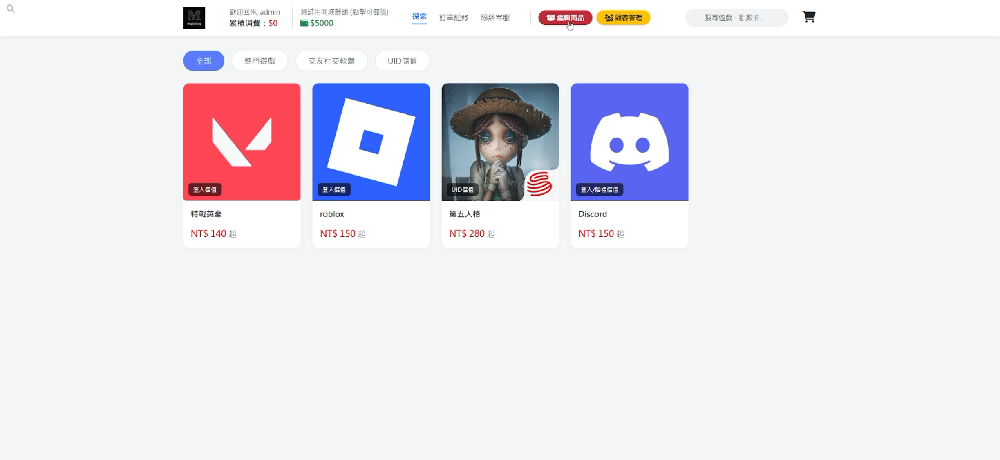
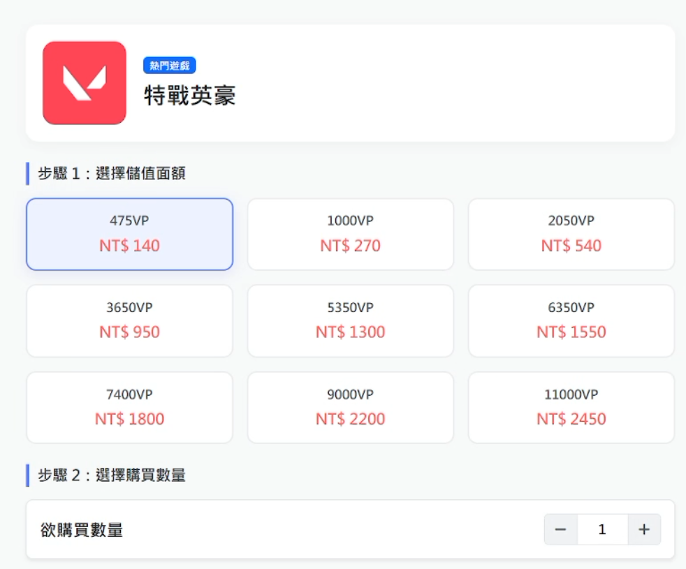
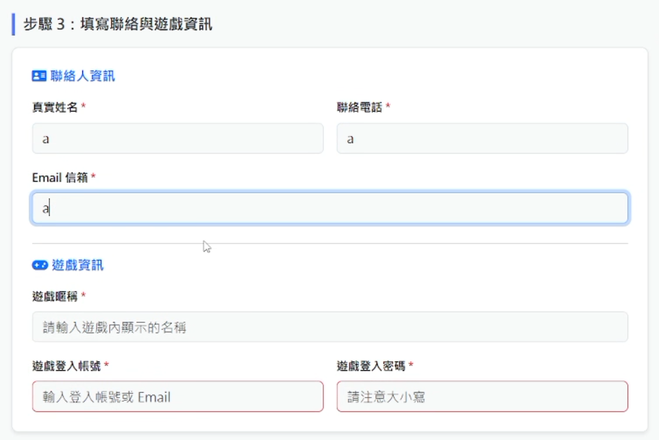
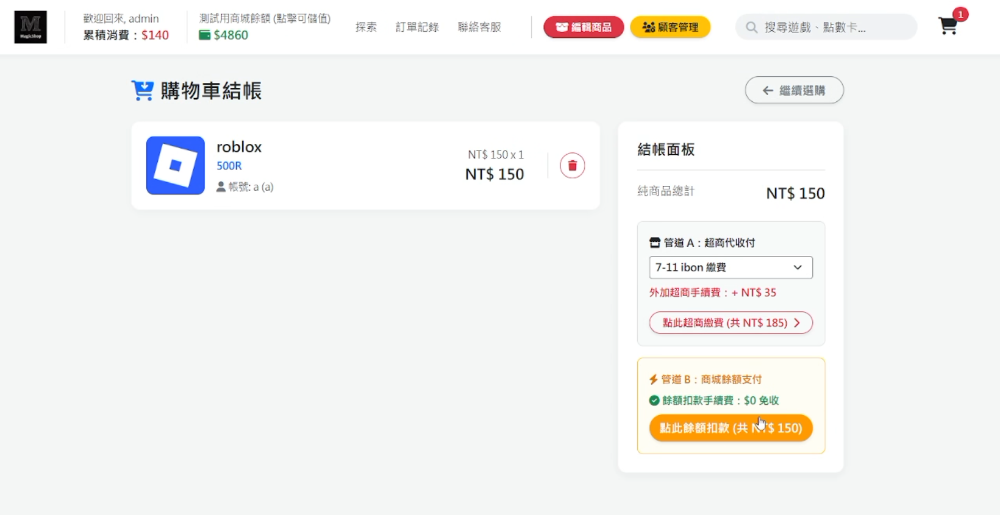
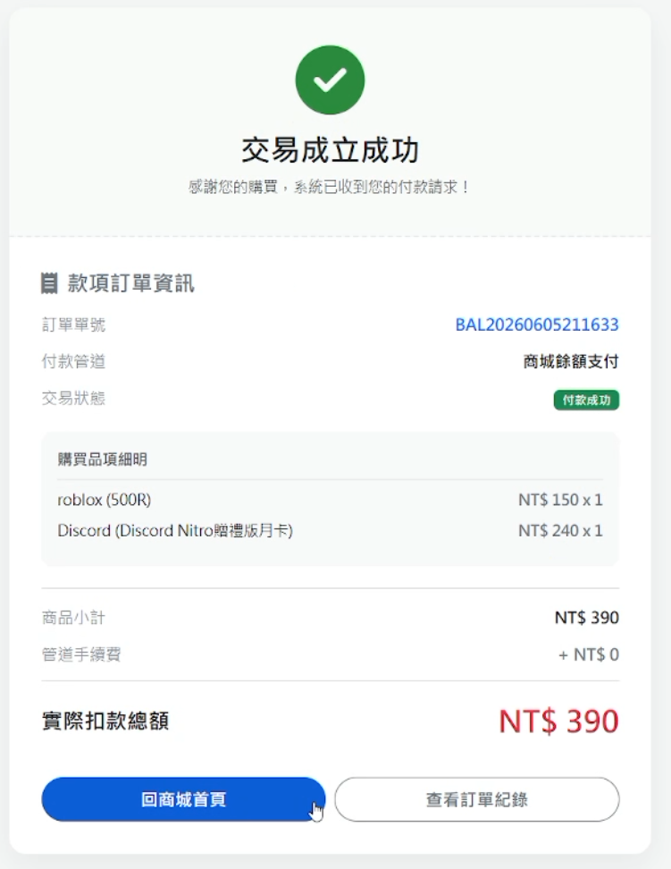
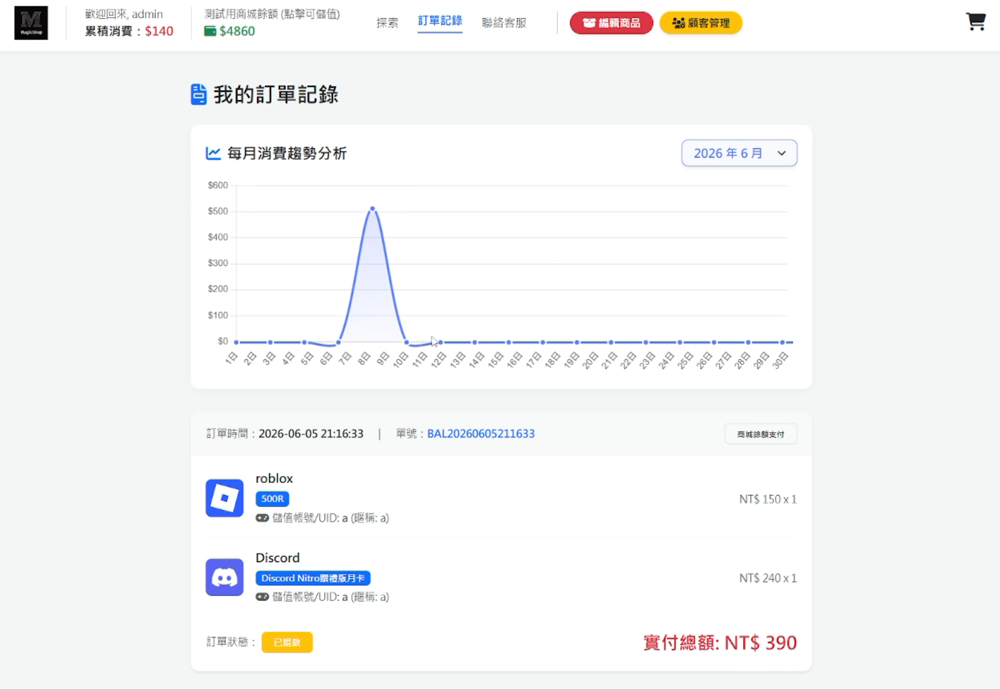
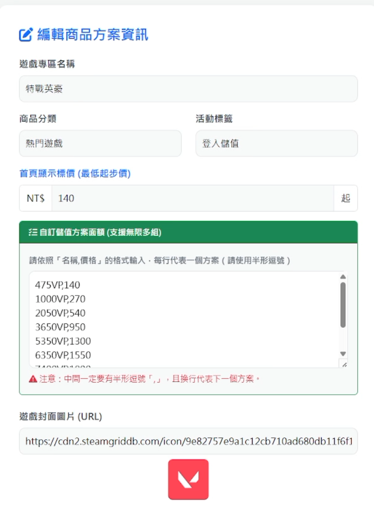

# 遊戲點數商店系統（ASP.NET MVC 課程專題）

以 ASP.NET Core MVC 製作的遊戲點數商城，包含前台下單流程與後台管理。這是課程專題，僅作示範，請勿直接用於正式環境。

## 功能

- 會員登入與註冊
- 商品瀏覽與分類（前端篩選）
- 商品頁：選擇方案、數量，並填寫聯絡與遊戲資訊
- 購物車與結帳（商城餘額支付、超商代碼，皆為示範流程）
- 訂單記錄，以及每月消費趨勢圖（Chart.js）
- 後台商品管理：新增、編輯、刪除
- 後台會員管理：新增、編輯、刪除，可修改會員餘額

## 技術

ASP.NET Core MVC（.NET 8）、Razor、Bootstrap、Entity Framework Core、SQL Server、Chart.js

## 如何執行

1. 安裝 Visual Studio 2022 與 .NET 8 SDK。
2. 準備一個 SQL Server 資料庫，依序執行 `schema.sql`、`1131740/SQLQuery2.sql`、`1131740/SQLQuery3.sql`（`schema.sql` 為依資料模型推導的草稿，請依實際情況調整）。
3. 修改 `1131740/appsettings.json` 的 `ConnectionStrings:CmsContext`，換成你自己的資料庫連線資訊。
4. 若要測試超商代碼付款，需自行申請速買配商家代號與驗證碼，填入 `1131740/Controllers/ShopController.cs` 的 `Dcvc` 與 `Verify_key`（目前是範例值）。
5. 在資料表 `TableMembers1131740` 新增一筆 `Username = admin` 的帳號（程式以此判斷管理員）。
6. 開啟 `1131740.sln`，使用 `https` 設定執行。

聯絡頁（`1131740/Views/Shop/Contact.cshtml`）的 Discord、LINE、Instagram 連結皆為範例值，請換成自己的。

## 已知限制

- 密碼以明文儲存與比對，未做雜湊。
- 訂單資料存放在 `wwwroot/orders.json`，不在資料庫，且該資料夾為公開靜態資料夾。
- 遊戲帳號與密碼以明文存放並顯示於後台。
- 以上皆為課程示範簡化，正式環境需改善。

## 畫面

